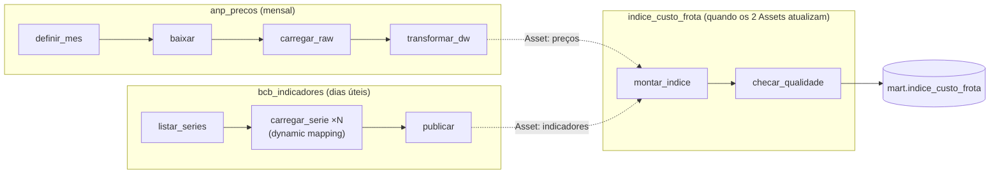

# 🚚 Fleet Cost Pipeline


Pipeline orquestrado com **Apache Airflow** que responde uma pergunta de orçamento:

> **O combustível da frota ficou mais caro de verdade, ou só acompanhou a inflação?**

O diesel subir 6% em seis meses parece muito. Se a inflação do período foi 3%, o aumento real foi de pouco mais de 3%. É esse segundo número que importa para revisar orçamento e contratos.

Parte 3 de 3 do portfólio **Custo de frota no Brasil**, juntando os dois projetos anteriores:
1. [fuel-price-warehouse](https://github.com/GustavoCabral22/fuel-price-warehouse): modelagem e SQL
2. [economic-indicators-etl](https://github.com/GustavoCabral22/economic-indicators-etl): ingestão em Python
3. **fleet-cost-pipeline** (este): orquestração

## Arquitetura



| DAG | Quando roda | O que faz |
|---|---|---|
| `anp_precos` | Dia 10 de cada mês | Baixa o CSV do mês anterior, carrega na camada raw com `COPY` e transforma no star schema |
| `bcb_indicadores` | Dias úteis, 9h UTC | Carga incremental de IPCA, Selic e dólar; uma task por série, criadas dinamicamente |
| `indice_custo_frota` | **Sem horário fixo:** quando preços **e** indicadores forem atualizados | Monta o índice nominal e real e valida antes de publicar |

## Resultado

Tabela `mart.indice_custo_frota`, pronta para Power BI (exemplo com a amostra sintética dos testes):

| ano_mes | produto | preço nominal | IPCA mês | preço real (R$ de jun/25) | var. nominal | var. real |
|---|---|---|---|---|---|---|
| 2025-01 | DIESEL | 5,938 | 0,16% | 6,106 | 0,00% | 0,00% |
| 2025-03 | DIESEL | 6,150 | 0,56% | 6,207 | 3,56% | 1,65% |
| 2025-06 | DIESEL | 6,324 | 0,24% | 6,324 | 6,50% | 3,57% |

O cálculo está comentado em [`include/sql/mart/indice_custo_frota.sql`](include/sql/mart/indice_custo_frota.sql).

## Como rodar

Pré-requisito: Docker.

```bash
make up
```

1. Abra http://localhost:8080
2. Ative as três DAGs
3. Dispare `bcb_indicadores` e `anp_precos` (nesta, informe `ano_mes` para escolher o mês)
4. Quando as duas terminarem, `indice_custo_frota` roda sozinha
5. Consulte o resultado: `psql -h localhost -p 5434 -U postgres -d frota -c "SELECT * FROM mart.indice_custo_frota"` (senha `postgres`)

## Boas práticas aplicadas

- **Agendamento orientado a dados (Assets):** o índice não roda num horário "chutado"; roda quando os insumos chegam.
- **Dynamic task mapping:** uma task por série do BCB, sem copiar e colar código.
- **Idempotência em todas as camadas:** recarregar um arquivo da ANP substitui o anterior; upserts nos indicadores; o mart é reconstruído numa transação.
- **Qualidade antes de publicar:** `SQLCheckOperator` valida o resultado. Se falhar, o Asset final não é emitido e ninguém consome número errado.
- **Retries** em todas as tasks, **catchup desligado** e **reprocessamento por parâmetro** (`ano_mes`).
- **Testes no CI:** integridade das DAGs (import, tags, retries, dependências) e testes de SQL num PostgreSQL real, incluindo a conta do preço real.

## Estrutura

```
├── dags/
│   ├── anp_precos.py
│   ├── bcb_indicadores.py
│   └── indice_custo_frota.py
├── include/
│   ├── anp.py, bcb.py      # lógica de ingestão (testável fora do Airflow)
│   ├── assets.py           # Assets compartilhados entre as DAGs
│   └── sql/
│       ├── ddl/            # raw, dw, indicadores e mart (criados na subida do banco)
│       ├── transform/      # raw -> star schema
│       └── mart/           # índice de custo de frota
└── tests/                  # integridade das DAGs + SQL com banco real
```

## Próximos passos

- [ ] Alertas de falha por e-mail ou Slack (`on_failure_callback`)
- [ ] Trocar a camada de transformação por **dbt** (orquestrado pelo Airflow com Cosmos)
- [ ] Dashboard em Power BI lendo `mart.indice_custo_frota`

## Fontes dos dados

- [ANP: Série histórica de preços de combustíveis](https://www.gov.br/anp/pt-br/centrais-de-conteudo/dados-abertos/serie-historica-de-precos-de-combustiveis)
- [Banco Central do Brasil: SGS](https://www3.bcb.gov.br/sgspub/)
